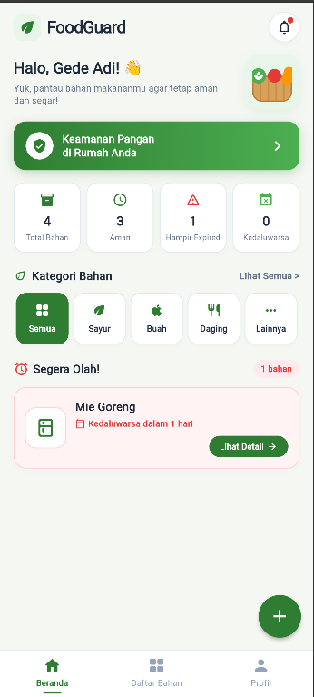
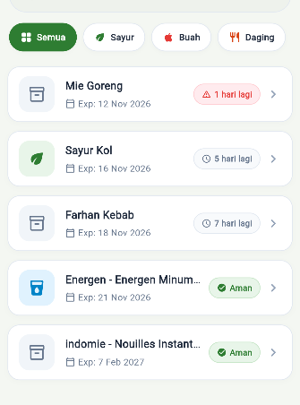
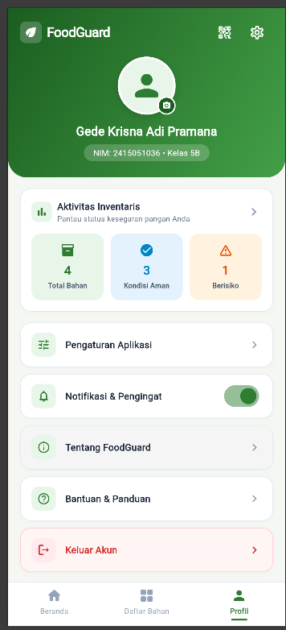
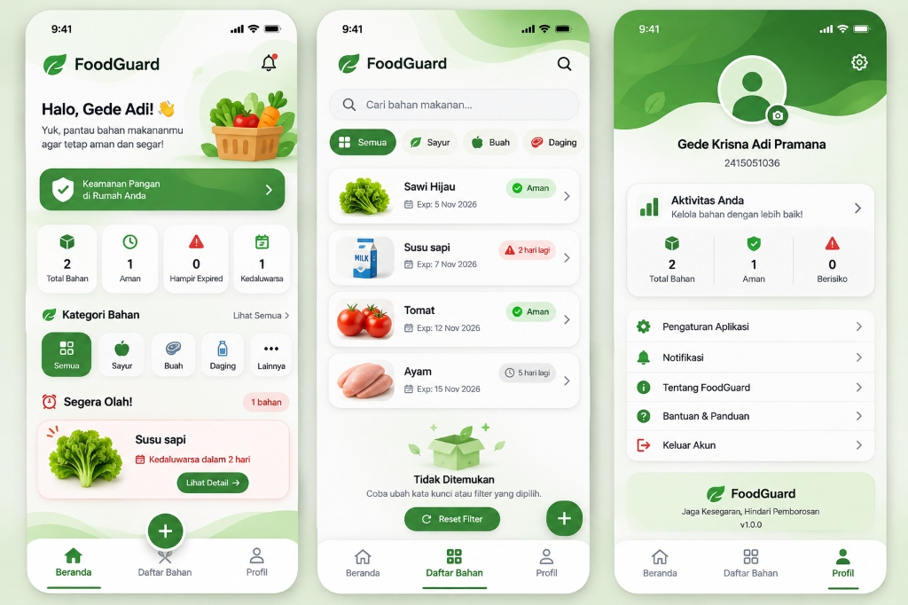

# 🌿 FoodGuard — Food Expiry Tracker & Waste Prevention

> **Ujian Tengah Semester (UTS) Pemrograman Mobile**  
> **Aplikasi Pemantau Tanggal Kedaluwarsa Bahan Makanan & Pencegah Pemborosan Pangan**

---

## 👨‍🎓 Identitas Mahasiswa

| Keterangan | Data Mahasiswa |
| :--- | :--- |
| **Nama Lengkap** | Gede Krisna Adi Pramana |
| **NIM** | 2415051036 |
| **Kelas** | 5B |
| **Program Studi** | S1 Pendidikan Teknik Informatika (PTI) |
| **Jurusan** | Teknik Informatika |
| **Fakultas** | Fakultas Teknik dan Kejuruan |
| **Universitas** | Universitas Pendidikan Ganesha (Undiksha) |
| **Mata Kuliah** | Pemrograman Mobile |

---

## 📱 Tentang FoodGuard

**FoodGuard** adalah aplikasi mobile berbasis Flutter yang dirancang untuk membantu pengguna mencatat, memantau, dan mengelola tanggal kedaluwarsa bahan makanan rumah tangga secara efektif. 

Dengan integrasi **cloud database Supabase**, pemindai **barcode kamera native (CameraX & ML Kit)**, serta **REST API Open Food Facts global**, pengguna dapat mendeteksi, mengategorikan, serta memanfaatkan bahan makanan sebelum kedaluwarsa atau terbuang sia-sia.

---

## 📸 Tangkapan Layar Aplikasi (Screenshots)

| Beranda (Dashboard) | Katalog Bahan Makanan | Profil & Pengaturan |
| :---: | :---: | :---: |
|  |  |  |

| Desain Mockup Referensi UI |
| :---: |
|  |

---

## ✨ Fitur Utama Aplikasi

1. **Dashboard & Ringkasan Inventaris**:
   - Statistik real-time: Total Bahan, Kondisi Aman, Hampir Expired (≤ 3 hari), dan Kedaluwarsa.
   - Peringatan banner interaktif *"Perlu Diolah Segera"* untuk bahan pangan berisiko.
   - Filter cepat kategori (Semua, Sayur, Buah, Daging, Lainnya).
   - Lembar notifikasi riil pengingat bahan mendekati batas tanggal kedaluwarsa.

2. **Manajemen Data CRUD Lengkap (Cloud Supabase)**:
   - **Create**: Formulir tambah bahan makanan lengkap dengan validasi form, date picker custom, dan upload/pilih gambar.
   - **Read**: Tampilan daftar inventaris dengan pencarian cepat (*live search*), filter kategori multi-chip, dan urutan status kesegaran.
   - **Update**: Formulir edit data bahan makanan yang sudah tersimpan di database.
   - **Delete**: Penghapusan data permanen (*Hard Delete*) dengan dialog konfirmasi keamanan.

3. **Status Konsumsi & Tracking (Soft Delete)**:
   - Pelacakan status siklus bahan pangan: `tersedia`, `dikonsumsi`, dan `dibuang`.
   - Pemulihan status bahan sewaktu-waktu.

4. **Pemindai Barcode Kemasan Kamera (ML Kit & CameraX)**:
   - Membaca barcode kemasan secara instan menggunakan kamera ponsel.
   - Fitur senter (flashlight), ganti kamera depan/belakang, input manual barcode, dan katalog barcode demo.
   - Dilengkapi ProGuard rules untuk build Release APK anti-crash.

5. **Integrasi REST API Publik (Open Food Facts)**:
   - Integrasi langsung dengan API publik Open Food Facts (`world.openfoodfacts.org`).
   - Pencarian produk makanan otomatis (*debounce live search*).
   - Auto-fill nama produk, kategori, merek dagang, kuantitas, dan estimasi masa simpan otomatis ke formulir input.

6. **Desain Tata Letak Responsif (LayoutBuilder & MediaQuery)**:
   - Mode ponsel vertikal (< 600px): Tata letak compact dengan *BottomNavigationBar* dan *ListView*.
   - Mode tablet / landscape (≥ 600px): Tata letak responsif dengan *NavigationRail* dan multi-kolom *GridView*.

7. **Profil Mahasiswa & Pengaturan**:
   - Header lengkung modern dengan foto profil yang dapat diganti via Galeri atau Kamera (`image_picker` + `shared_preferences`).
   - Kartu identitas mahasiswa (Nama, NIM, Kelas 5B).
   - Pengaturan notifikasi harian, tema gelap, dialog informasi aplikasi (*Tentang FoodGuard*), bantuan panduan penggunaan, serta dialog keluar akun.

---

## 🏛️ Arsitektur Aplikasi

Aplikasi dibangun menggunakan pola arsitektur bersih (**Clean Architecture & Repository Pattern**) dengan pemisahan tanggung jawab (*Separation of Concerns*):

```
UI (Screens & Reusable Widgets)
       │
       ▼
State Management (ChangeNotifier - BahanProvider)
       │
       ▼
Data Access Layer (BahanRepository)
       │
       ├─────────────────────────┬─────────────────────────┐
       ▼                         ▼                         ▼
SupabaseService           BarcodeService            FoodApiService
(Cloud PostgreSQL)      (Local + Camera)      (Open Food Facts API)
```

### 📂 Struktur Direktori Kode:
```
lib/
├── main.dart                      # Inisialisasi app, tema global, & Supabase client
├── models/
│   ├── bahan_makanan.dart         # Model data BahanMakanan & kalkulasi kedaluwarsa
│   └── food_api_product.dart      # Model data produk dari REST API Open Food Facts
├── services/
│   ├── supabase_config.dart       # Konfigurasi URL & Anon Key Supabase
│   ├── supabase_service.dart      # Operasi CRUD cloud database Supabase
│   ├── barcode_service.dart       # Barcode scanner lookup & database demo lokal
│   └── food_api_service.dart      # Client HTTP REST API Open Food Facts
├── repositories/
│   └── bahan_repository.dart     # Abstraksi data access layer (DAL)
├── providers/
│   └── bahan_provider.dart        # State management global (ChangeNotifier)
├── widgets/
│   ├── bahan_card.dart            # Kartu item bahan makanan responsif (List & Grid)
│   ├── expired_badge.dart         # Kapsul status warna kedaluwarsa
│   ├── kategori_chip.dart         # Baris chip pemilih kategori bahan
│   ├── empty_state_widget.dart    # Widget empty state & penanganan error
│   ├── delete_confirmation_dialog.dart # Dialog konfirmasi hapus data
│   └── open_food_facts_sheet.dart # Bottom sheet pencarian produk REST API
└── screens/
    ├── home_screen.dart           # Dashboard utama, statistik, & navigasi tab
    ├── food_list_screen.dart      # Layar katalog inventaris responsif
    ├── food_detail_screen.dart    # Layar rincian detail bahan makanan
    ├── add_food_screen.dart       # Layar formulir tambah bahan baru
    ├── edit_food_screen.dart      # Layar formulir edit bahan makanan
    ├── barcode_scanner_screen.dart# Layar kamera pemindai barcode
    └── profile_screen.dart        # Layar profil mahasiswa & pengaturan
```

---

## 🚀 Cara Menjalankan Project

### Prasyarat:
- Flutter SDK versi 3.13.2 ke atas (direkomendasikan versi terbaru)
- Android Studio / VS Code dengan ekstensi Flutter & Dart
- Perangkat Android fisik atau Emulator Android (API Level 21+)

### Langkah-langkah Instalasi:

1. **Clone Repositori Git**:
   ```bash
   git clone https://github.com/gedek0815-maker/UTS_2415051036_Gede_Krisna_Adi_Pramana.git
   cd foodguard
   ```

2. **Pasang Dependensi**:
   ```bash
   flutter pub get
   ```

3. **Verifikasi Analisis Kode**:
   ```bash
   flutter analyze
   ```
   *(Pastikan output menampilkan: `No issues found!`)*

4. **Jalankan Aplikasi dalam Mode Debug**:
   ```bash
   flutter run
   ```

5. **Build APK Release Siap Pasang**:
   ```bash
   flutter build apk --release
   ```
   *File APK release akan tersimpan di:*
   `build/app/outputs/flutter-apk/app-release.apk`

---

## 📌 Riwayat Tahap Pengerjaan Proyek (Tahap 01 – 21)

| Tahap | Pesan Commit Git | Deskripsi & Ruang Lingkup |
| :---: | :--- | :--- |
| **01** | `Initialize FoodGuard Flutter UTS project` | Inisialisasi awal proyek Flutter UTS Pemrograman Mobile |
| **02** | `Setup project architecture and folder structure` | Setup struktur folder modular: `models/`, `services/`, `repositories/`, `providers/`, `widgets/`, `screens/` |
| **03** | `Add BahanMakanan model with expired helper methods` | Pembuatan data model, parser JSON, dan helper kalkulasi hari kedaluwarsa |
| **04** | `Setup Supabase connection and initialize in main.dart` | Konfigurasi Supabase client dan inisialisasi pada root aplikasi |
| **05** | `Add SupabaseService with CRUD operations` | Implementasi operasi Create, Read, Update, Delete ke cloud database |
| **06** | `Add BahanRepository as data access layer` | Implementasi Repository Pattern sebagai perantara data |
| **07** | `Implement BahanProvider with ChangeNotifier` | State management reaktif menggunakan Provider & ChangeNotifier |
| **08** | `Build app theme, colors, and base UI setup` | Palet tema hijau (#2E7D32, #F4F7F2) dan konfigurasi tipografi Poppins |
| **09** | `Add reusable widgets: BahanCard, ExpiredBadge, KategoriChip, EmptyState` | Pembuatan komponen UI terpisah, modular, dan reusable |
| **10** | `Build HomeScreen dashboard with summary cards and bottom navigation` | Layar dashboard beranda, 4 kartu statistik, dan navigasi tab utama |
| **11** | `Implement responsive layout using LayoutBuilder for list and grid view` | Desain adaptif responsif (ListView ponsel, GridView multi-kolom tablet) |
| **12** | `Add FoodDetail screen with navigation and data passing` | Layar detail bahan makanan beserta passing data antar-layar |
| **13** | `Add AddFoodScreen with form validation and floating action button` | Formulir tambah bahan, validasi input, dan integrasi Open Food Facts |
| **14** | `Add EditFoodScreen and wire edit actions in detail and list screens` | Formulir ubah data bahan makanan yang sudah tersimpan |
| **15** | `Implement delete confirmation dialog and delete food functionality` | Dialog konfirmasi keamanan sebelum eksekusi hapus data |
| **16** | `Implement soft delete and food consumption status management` | Manajemen status bahan pangan (`tersedia`, `dikonsumsi`, `dibuang`) |
| **17** | `Add barcode scanner feature using mobile_scanner package` | Fitur scan barcode produk via kamera perangkat menggunakan `mobile_scanner` |
| **18** | `Add loading, error, and empty state handling across all screens` | Penanganan loading spinner, error feedback, dan UI empty state interaktif |
| **19** | `Add Profile screen with app info and settings` | Layar profil mahasiswa (Gede Krisna Adi Pramana - 2415051036 - Kelas 5B) |
| **20** | `Refine UI consistency, fix responsive issues, and improve UX` | Polish UI mockup 3 tab, image picker profil (galeri & kamera), dan penyesuaian kelas 5B |
| **21** | `Finalize FoodGuard app, add README and documentation` | Dokumentasi final lengkap, dokumentasi tangkapan layar, panduan menjalankan app |

---

## ⚖️ Lisensi & Hak Cipta

Proyek ini dikembangkan sebagai karya **Ujian Tengah Semester (UTS) Mata Kuliah Pemrograman Mobile**.  
© 2026 **Gede Krisna Adi Pramana** (NIM: 2415051036) — Kelas 5B  
Program Studi Pendidikan Teknik Informatika — Universitas Pendidikan Ganesha
